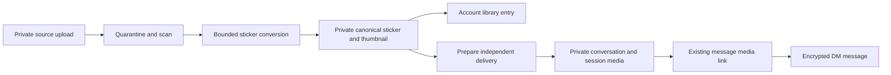

# DM emoji, GIF, and sticker keyboard

Status: implementation in progress, 23 October 2026. The user-selected library limit is 1,000 stickers per account; other limits below are selected defaults for the first implementation slice.

## Implementation progress

The first end-to-end slice now includes the shared sticker message contract, private image/GIF upload and bounded WebP conversion, a private account library with the 1,000-entry and 500 MiB caps, independent conversation-bound delivery copies, keyset-paged My/Recent/Favorites collections, and a three-tab expression keyboard in the web and native DM composers. The message reader gives stickers a bubble-free presentation on both clients. Sticker creation is disabled in incognito; existing saved stickers can still be sent.

The Prisma contract and additive migration plans have been generated, reviewed, and applied to the configured local `.env.test` database through `bun run db:up`. No shared/staging/production database was changed. Received-sticker saving, an image crop/preview step, reservation-backed storage/conversion quotas, animation playback concurrency controls, and device-level verification remain outstanding before the full proposal is complete.

## 1. Product contract

Add one expression button beside the DM input. It opens one keyboard with three tabs, in this order: **Emoji · GIFs · Stickers**. Keep the attachment button for photos, videos, and files.

Ship the same behavior on desktop web, mobile web, Android, and iOS. The launch scope is one-to-one DMs, including their normal and incognito modes. Dens and community chat can adopt the shared components later; do not accidentally enable sticker writes there merely because they reuse a composer.

The first release includes:

- Searchable Unicode emoji with categories, skin tones, and recent selections.
- The existing KLIPY GIF service inside the GIF tab.
- A private, account-owned sticker library with My stickers, Recent, Favorites, and Create sticker.
- Static stickers made from JPEG, PNG, or static WebP uploads, and animated stickers made from GIF uploads.
- A simple crop/fit preview, creation progress, reusable stickers, and a dedicated sticker appearance in the transcript.
- Explicit saving of received stickers from ordinary, non-expiring DMs.

Public sticker discovery, shareable packs, provider sticker APIs, video-to-sticker conversion, animated WebP/APNG input, automatic background removal, drawing, outlines, and text overlays are later additions. A JPEG becomes an opaque sticker unless the user supplies an image with transparency. Do not suggest that resizing removes its background.

## 2. Findings from the current code

| Existing code | Consequence for implementation |
| --- | --- |
| Web and native `message-composer.tsx` have separate GIF controls and attachment staging. Web GIF selection downloads the GIF and stages it for Send. | Replace the DM GIF entry with the unified expression keyboard and preserve the current GIF staging behavior. |
| `packages/messages/src/reactions.ts` supplies a lazy emoji catalogue, search, categories, and skin variants. Web and native reaction pickers already use it. | Extract reusable catalogue/grid behavior without turning composer emoji selections into reactions or adding another emoji dependency. |
| `packages/messages/src/payload.ts` reads legacy single media, albums, and newer attachment lists. Both clients use shared payload contracts. | Add a validated sticker presentation that preserves existing media decoding. |
| `extractMessageReferences()` feeds the media IDs used when sending messages, in addition to search/shared-content references. | Sticker exclusion from galleries must not remove the media ID needed for authorization and lifecycle linking. |
| Media upload initiation has a fixed purpose enum; purpose is currently not persisted. | Add an authoritative, persisted sticker conversion record. Merely passing `purpose: sticker` cannot tell a later worker which recipe to run. |
| `PostMedia.messageConversationId` binds a media row to one conversation; `linkLifecycleMedia()` requires sender ownership, matching conversation/session, and READY status. | A reusable library media row cannot be attached directly to every DM or rebound on each send. |
| Message media links enforce current access, source visibility, deletion, recovery epochs, and incognito expiry. | Create independent chat deliveries and reuse these checks for every sticker rendition. |
| `process-image.ts` explicitly skips ordinary image derivatives for animated input. | A GIF sticker needs a dedicated animation-preserving processing recipe. |
| Native `message-image-source.ts` supplies authenticated, account-scoped media URLs and ordinarily uses persistent caching. | Reuse authentication; make cache policy follow sticker delivery lifecycle instead of blindly reusing the persistent default. |
| The existing media pipeline has quarantine, scanning, processing queues, object storage, provenance, limits, and cleanup. | Extend those foundations instead of introducing a separate unaudited upload path. |

The message encryption model remains server-recoverable encryption. Sticker support must preserve its current recovery and authorization rules.

## 3. Keyboard behavior

### Shared shell

- The expression button toggles the keyboard. Its active state and accessible label reflect whether the expression panel is open.
- Desktop: use one anchored panel above the composer, clamped to the viewport. Mobile web/native: use a docked panel below the composer in place of the software keyboard, with safe-area handling. Avoid an overlay that conceals the latest messages.
- Preserve the transcript anchor and at-bottom behavior while the panel opens, closes, or changes size. Reuse the existing keyboard/viewport handling before adding new resize logic.
- Start on Emoji. Remember the last selected tab in account-scoped device preferences for normal chats. Incognito uses session memory and does not persist tab searches or usage history.
- Each tab has independent search and scroll state for the current open session. Switching tabs preserves those states. Closing clears searches and cancels in-flight searches; account changes clear all scoped state and requests.
- Mount only the active tab's heavy content. Opening Emoji must not fetch GIFs or download the entire sticker library.
- Restore input selection when inserting emoji. Switching back to typing, pressing Escape, or tapping Close returns focus predictably. On Android, Back closes the expression panel before navigating away.
- Disable media sending during text-message editing, lost membership, a block, an unavailable identity, or an incompatible chat mode. Keep emoji insertion available while editing text. Existing view-once attachment staging cannot mix with stickers.
- Use the current `@asm/ui` panel, tab, input, dialog, and button primitives, plus existing 3D recipes. Keep web styling in Tailwind; new recipes belong in `@layer components`, with class-based theme behavior.

### Emoji tab

- Reuse the current emoji dataset and matching functions, with a reusable selection callback for composer insertion or message reaction.
- Insert the full emoji sequence at the saved caret, replacing selected text without losing the rest of the draft. Keep the panel open for multiple insertions.
- Preserve normal textarea/TextInput change handling, draft updates, typing indicators, length limits, and undo behavior where supported. Do not manually split joined emoji or skin-tone sequences.
- Show categories, search, tone preference, and up to 36 recent emoji. Store ordinary recents per account on the device; incognito selection does not update them.
- Cover selection at the beginning, middle, and end of a draft, IME composition, RTL text, selection replacement, and focus transitions to the search field.

### GIF tab

- Reuse `/api/gifs/trending`, `/api/gifs/search`, and the current server-held KLIPY key.
- Extract a configurable picker body so the DM shell does not change GIF controls in comments/posts.
- Preserve selection -> attachment preview -> Send. Selecting a GIF does not unexpectedly transmit the typed draft.
- Add cancellation/request identity so an older search response cannot replace newer results. Keep approximately 350 ms debounce, explicit loading/empty/error/retry states, and bounded pagination.
- Return 24 results per page as today, retaining at most three pages in the active picker. Use `hasNext` for pagination, not as an exact total. Verify any new provider attribution or filtering requirements before changing provider integration.
- Bound full GIF downloads using the existing attachment limit before or during streaming, including when Content-Length is absent. Do not allocate an unlimited response blob.
- A GIF provider failure affects only this tab; emoji and saved stickers remain usable. Do not label a request failure as no results.

### Stickers tab

- Show a compact filter strip for My stickers, Recent, and Favorites, with Create sticker clearly visible. These are filters inside Stickers, not additional top-level keyboard tabs.
- The initial empty state offers Create your first sticker. No external catalogue or starter pack is required for launch.
- Search private names and optional tags. Keep search private to the account and separate from GIF-provider requests and message-history search.
- Tapping a saved sticker sends one standalone sticker immediately. Keep the panel open for another selection; mark the tile pending and prevent accidental duplicate activation while its send is unresolved.
- Preserve typed text and staged attachments. Consume the active reply target only after the sticker send succeeds. If an upload/view-once batch or another send is actively committing, temporarily disable sticker send with a contextual state.
- On failure, show a local Retry on the pending message or tile. Keep its original operation ID and delivery; retry must not send a second copy after an ambiguous successful response.
- Long press/context menu on a library sticker provides Favorite, Rename, and Remove from My stickers. Removal copy explains that previous messages stay in chat; an Undo action may restore the entry within a short deletion grace period.
- Use a static thumbnail in grids. Preview one animation on deliberate hover/focus/tap. Never autoplay every visible grid item.

## 4. Create sticker flow

1. Choose Create sticker and upload one supported image/GIF from the system picker. Drag/drop and paste can feed the same flow when the creator is open; ordinary composer paste remains an ordinary attachment.
2. Validate source type and byte size immediately. Display format/size guidance beside the picker and useful, specific validation errors.
3. Show a contained preview with crop versus fit, pan/zoom, Reset, and an optional name. Static images also support rotation. Fit preserves the full image on transparent padding; Crop applies the same rectangle to every GIF frame. GIF trimming and per-frame editing are outside this release.
4. Send normalized crop coordinates and a recipe version with the source. The server independently validates all coordinates and dimensions. Client previews are advisory; they do not establish the saved bytes.
5. Upload through the existing signed-upload/quarantine/scan stages, then run the sticker recipe. Present Uploading, Processing, Ready, or a useful failure beside this one creation. Allow cancellation without clearing the DM draft.
6. Show the final server-produced preview. Save sticker adds it to the library. Offer a separate Send action after it is ready; creation never silently sends it.
7. A pending conversion can be revisited after navigation or on another device. Expire unconfirmed output after 24 hours; committed library entries remain until removed. Idempotent Save does not create another library entry.

For the first release, incognito exposes existing saved stickers but disables creation and saving received stickers. This avoids persisting new source material or usage records from a temporary conversation. An existing personal sticker library remains independent of incognito messages.

On Android, preserve animated GIF selection with `quality: 1` and `allowsEditing: false`, then use our own preview/recipe. Expo documents that other combinations can return a flattened first frame. Verify this against SDK 57 and physical-device fixtures. [Expo 57 ImagePicker](https://docs.expo.dev/versions/v57.0.0/sdk/imagepicker/)

## 5. Proposed limits

These defaults apply on the server and are mirrored by shared browser-safe constants. One MiB is 1,048,576 bytes. A policy endpoint returns effective overrides so clients do not promise stale limits.

| Constraint | Proposed initial limit |
| --- | --- |
| File selection | One file per creation; JPEG, PNG, static WebP, or GIF |
| Static input | 5 MiB, at most 4,096 px on either edge, at most 12 million pixels |
| Animated input | 10 MiB, at most 1,024 px per frame edge, 3 seconds, 60 frames, and 32 million cumulative decoded pixels |
| Saved output | Static/animated WebP contained within a 512 × 512 transparent canvas; never enlarge the subject beyond source resolution |
| Static output bytes | 256 KiB maximum |
| Animated output bytes | 512 KiB maximum, preserving animation timing within the 3-second/60-frame source bound |
| Grid thumbnail | Static WebP, up to 128 × 128 and 16 KiB |
| Library | 1,000 active saved entries and 500 MiB of final sticker/thumbnail bytes per account, whichever is reached first |
| Creation admission | 10 admitted creation attempts per rolling 24 hours, at most 3 starts/minute, at most 2 active conversions per account |
| Delivery preparation | At most 3 unclaimed prepared deliveries per account; expire after 1 hour |
| Names/tags | Name up to 64 Unicode code points; at most 5 tags of 24 code points each |
| Picker retrieval | 40 sticker entries per page, at most 3 retained pages; 30 Recent entries |
| Processing | 30-second conversion deadline; isolated process/container budget of 512 MiB; start with 1 active sticker conversion per worker replica |
| Abandoned source/output | Reclaim after 24 hours; successful source cleanup also occurs within 24 hours once final output is committed |

Apply the stricter of sticker limits and existing account-wide upload/storage limits. Include source storage, pending reservations, output, and delivery copies in the appropriate total account storage accounting. Sticker sending follows existing message anti-spam rules; repeated sends must not increment the creation counter.

Reserve conversion slots and maximum output storage atomically before accepting bytes. Reconcile actual sizes at completion. Pending creates and saves from several devices cannot exceed count/storage caps. Release reservations on cancellation, terminal failure, or abandonment; retries of the same operation do not reserve twice. An admitted processing failure still counts toward the daily abuse budget, but polling and retries of that operation do not. Refund service-caused failures where attributable.

Reject oversized dimensions, animation duration, frame count, and cumulative frame pixels before full decoding where possible; retain decoder limits, process memory caps, and deadlines because headers are untrusted. Use a bounded encoder quality ladder with a fixed attempt count. If output still exceeds its cap, reject with a useful request for a simpler/smaller source. Never publish an over-limit original as a fallback or silently flatten an animation.

Calibrate these defaults with realistic sources and device tests before release. In particular, the 3-second GIF limit is intentionally a small-sticker policy and should appear before upload.

## 6. Storage, ownership, and chat delivery

Keep reusable library content separate from each send:



### Library asset

- Store canonical normalized WebP plus a static thumbnail in private storage. The source filename, EXIF/GPS, comments, and unnecessary source metadata never reach recipients.
- Keep canonical library access owner-only. Sharing a sticker does not grant access to the creator's library, filenames, private names/tags, or conversion source.
- Persist an immutable recipe version, validated dimensions, animation metadata, byte sizes, checksum, and output revision. A rename changes the library entry, not historical messages or bytes.
- Keep the final canonical output independently of the short-lived source. Adapt ordinary media retention/orphan sweeps so they recognize committed library assets; a row without post/comment/conversation ownership is not necessarily abandoned.
- Preserve the platform's provenance/watermark policy. Verify alpha edges and animation survive the required stages. Do not reuse a static-only stamper that flattens GIF frames or silently bypass existing provenance requirements.

### Per-send delivery

- Prepare a new sender-owned `PostMedia` row, bound to the target conversation and, where applicable, the exact incognito session. Use independent private storage keys for the normalized output and thumbnail.
- Copy trusted, completed canonical bytes server-side through a controlled internal path. Do not fetch a URL supplied by the client, re-upload from the browser, expose a public bucket key, or run the general image recipe again.
- Preserve the original provenance identity when copying signed/watermarked bytes. A delivery ID is an access/lifecycle identity, not a claim that the canonical artwork was newly created.
- Require canonical READY status and complete validated outputs. Publish a delivery as READY only after its copies and manifests are complete. A missing derivative cannot fall back to a canonical library route.
- Validate active sender membership, blocks, current retention version, session, library ownership, revocation, and account quotas both when preparing and when committing the message.
- At commit, claim the prepared delivery and create the message/media link atomically. Another conversation, session, sender, message, or duplicate request cannot consume the same preparation.
- Physical object copies make deletion and incognito erasure independent. This costs additional bounded storage per send; avoid introducing shared-object reference counting in the first release.
- Apply existing access checks to the original, thumbnail, derivatives, range requests, downloads, and export paths. Clients never use the canonical library media ID to authorize a received sticker.

### Deletion and saving received stickers

| Action | Result |
| --- | --- |
| Remove from My stickers | Stops future sends from that entry and removes favorites/recents; previously sent deliveries remain governed by their messages. |
| Delete/expire a message | Revokes that delivery immediately and erases its independent objects through existing cleanup; canonical library content stays available to its owner. |
| Clear/hide a chat for one viewer | Follows existing viewer-scoped visibility rules; does not delete the peer's readable message or an independently saved library entry. |
| End incognito / reach message expiry | Revokes and erases delivery bytes, including thumbnails and unsent preparations. Does not leave an incognito copy in library storage. |
| Save a received normal sticker | Rechecks readable source and non-expiring policy, then creates an independent private asset/entry owned by the recipient, subject to creation/storage limits. |
| Creator account deletion | Removes its private library and follows existing account/message deletion policy for deliveries; do not cascade through an origin foreign key into an independently saved recipient copy. |
| Administrative safety revocation | Denies affected assets and deliveries promptly, including derivatives; renders Sticker unavailable. Retain minimal revocation lineage needed for this operation. |

Saving received stickers is explicit, not automatic. Do not expose Save for incognito, disappearing, deleted, unavailable, or view-once content. A transaction/locking rule must prevent a save from racing expiry or policy changes. This applies to the whole received asset, not just what its client payload claims.

An independently saved sticker from a normal DM is a new retained copy. Later deleting the original message does not recall that copy. Explain this in the save action's contextual copy; do not promise recall of downloaded bytes.

## 7. Payload, sending, and compatibility

Use a validated sticker-specific media presentation while retaining a wire shape existing clients can render. Proposed payload:

```json
{
  "type": "media",
  "kind": "image",
  "url": "/api/media/delivery_media_id/v/sticker-full.webp",
  "width": 512,
  "height": 512,
  "presentation": "sticker",
  "sticker": {
    "version": 1,
    "deliveryMediaId": "delivery_media_id",
    "animated": false,
    "alt": "Sticker"
  },
  "replyToId": "optional_message_id"
}
```

Use `kind: gif` for an animated WebP sticker; this existing message kind denotes animated-image presentation. Verify actual older renderers accept the served WebP MIME rather than relying on a `.gif` suffix. The exact derivative route/name above is proposed and must fit the existing derivative resolver.

- New clients recognize `presentation: sticker` and use a sticker renderer. Older parsers currently tolerate extra fields on this valid single-media shape, so their intended fallback is an ordinary image/GIF bubble. Prove this with archived client fixtures before enabling writers.
- Add browser-safe `StickerMessagePayload`/`isStickerPayload` helpers and validation. A sticker is exactly one normalized image/animation, without a caption or album. Validate same-origin media path, IDs, metadata bounds, URL-to-delivery-ID agreement, and known presentation/recipe version.
- Keep private creator/library IDs out of the message payload. Store authoritative lineage on the server; explicit Save operates from message/delivery identity.
- The encrypted metadata controls appearance, never entitlement. The server binds claimed media IDs to authoritative prepared sticker deliveries and compares sticker metadata when decrypting through the existing trusted path if needed. All media requests enforce the delivery's policy regardless of how a malicious client labels it.
- Preserve media-ID extraction for sending. Classify sticker references as `mediaKind: sticker` or use a separate authorization extractor, then exclude them from ordinary photo/video galleries at the shared-content query boundary. Update server/offline reference unions together. Do not hide a sticker reference by dropping its lifecycle media ID.
- New clients exclude stickers from ordinary album/lightbox helpers. The payload stays valid for old photo fallback readers. Preview, reply, export, and push paths use a generic Sticker label where appropriate; private library names and tags never become notification content or full-history search terms.
- Preserve replies, receipts, reactions, selection, delete, reconnect replay, and incognito transport semantics. Sticker messages cannot be text-edited or given view-once delivery.

Use a stable client operation ID for preparation and message commit. Store a unique account/conversation/session-scoped key with the result. A lost response returns the committed message on retry; it must not simply advance the ratchet and send again. Before re-encrypting at another ratchet index, resolve ambiguous success by operation ID. Integrate this with current ratchet-conflict retry logic and serialize local sends as needed. Implement the same contract on the normal and incognito send paths.

If archived clients fail the image/GIF fallback, hold sticker writers behind a minimum-client/capability rollout until a safe reader is shipped. Do not ship a new top-level sticker type that older clients misreport as decryption failure.

Ordinary media fallback alone is insufficient for disappearing/incognito delivery: an older native reader may persist image bytes despite the newer server's intended cache policy. Require lifecycle-aware client capabilities for these modes and keep their sticker-send flag off until receiver behavior is verified. A sender-only version check cannot establish recipient cache behavior. Ordinary non-expiring DMs can use the tested image/GIF fallback independently.

## 8. Proposed persistence and API contracts

Names below are proposed implementation names, not existing tables/routes.

| Record | Purpose and important constraints |
| --- | --- |
| `StickerAssets` | Private canonical media ID, owner, recipe/output revision, immutable normalized metadata/checksum, state, and nullable revocation lineage. Canonical media is unique per asset. |
| `UserStickers` | Owner + asset unique, private name/tags, favorite, ordinary last-used time, created/removed timestamps, and revision. Count active and reserved entries atomically. |
| `StickerConversions` | Owner, source media, validated recipe, state, idempotency key, reservation/expiry, result asset, bounded failure code. Unique owner + operation key. |
| `StickerDeliveries` | Sender, asset/revocation lineage, independent delivery media ID, conversation, optional incognito session, operation ID, recipe revision, preparation state/expiry, and optional claimed message. Delivery media ID unique; enforce exactly one claimed normal/incognito source. |
| `StickerQuotaReservations` or equivalent transactional counters | Count/storage/concurrency reservations and release state. Avoid quota enforcement based only on Redis estimates. |

Use real foreign keys where they preserve the retention contract, plus explicit ownership and source constraints. Retained independent copies need nullable/non-cascading origin links. Bound indexes for owner listing, conversion work/expiry, prepared delivery expiry, source lookups, and revocation fan-out. Durable rows plus a sweep/outbox keep jobs recoverable if Redis delivery hints are lost.

| API | Contract |
| --- | --- |
| `GET /api/stickers/policy` | Effective input/output limits, supported formats, feature capabilities, remaining creation budget and library capacity. Private/no-store. |
| `GET /api/stickers` | Account-only keyset-paginated entries; My/Recent/Favorites filters and bounded private search; immutable media metadata and revision. |
| `POST /api/stickers/conversions` | Reserve quota and create an authenticated sticker-specific source upload/conversion with a validated recipe and idempotency key. Reuse existing upload transfer/complete APIs. |
| `GET /api/stickers/conversions/[id]` | Owner-only progress/result; bounded backoff and cancellation of polling on close/account switch. |
| `DELETE /api/stickers/conversions/[id]` | Idempotent cancellation; revoke publication and schedule cleanup/release reservations. A late worker cannot resurrect it. |
| `POST /api/stickers` | Idempotently save a ready conversion to the library; reconcile actual quota. |
| `PATCH /api/stickers/[id]` | Owner-only rename/tags/favorite with an expected revision. |
| `DELETE /api/stickers/[id]` | Idempotently remove the caller's entry; no historical message mutation. |
| `POST /api/messages/conversations/[id]/sticker-deliveries` | Prepare exactly one private send from an owned saved asset; bind operation/session/retention version and return delivery metadata. |
| Existing normal/incognito message sends | Accept the preparation/operation reference, validate it, and atomically claim delivery with message/media linking. |
| `POST /api/messages/conversations/[id]/messages/[messageId]/save-sticker` | Explicitly save one readable, ordinary non-expiring sticker to the caller's library under a new ownership boundary. |

Reuse authenticated media serving for library previews and delivery bytes; owner-only canonical rows and conversation-linked delivery rows have different admission checks. Use the repository's existing auth, CSRF/origin, validation, rate-limit, and structured error conventions. API responses never return storage keys or arbitrary source URLs.

Use explicit failure codes for unsupported format, too large, excessive animation, library full, daily limit, processing failed, source unavailable, mode changed, and revoked. Preserve drafts and provide actionable retries. Return Retry-After where a rate limit can expire; display quota information primarily in creation/library management.

Library mutations invalidate only the current account's queries. Refetch on foreground/reconnect using revisions; use an account-scoped invalidation event if the existing transport supports one. Incognito sends must not persist library last-used timestamps or update normal Recent/Favorites data.

## 9. Processing implementation

1. Reuse signed upload transfer, measured byte verification, file sniffing, quarantine, and malware scan. Allow only explicitly supported raster signatures; reject SVG, archives, polyglots/mismatches, and malformed sources under existing scanner policy.
2. Persist sticker purpose/recipe in `StickerConversions` before queueing so processing cannot accidentally select the ordinary image recipe. Do not rely on a transient request flag, inferred filename, or user-editable metadata.
3. Normalize EXIF orientation for static input, then validate/apply crop geometry and convert to sRGB. Preserve meaningful transparency; fit onto a transparent canvas without a background fill.
4. For GIF, validate page dimensions, frame count, cumulative pixels, disposal/compositing behavior, and total frame delays. Apply crop/fit consistently across frames and preserve playback timing. Require sane positive frame delays; reject unsupported/pathological timing rather than trusting browser-specific defaults.
5. Encode static/animated WebP and a static thumbnail with the bounded recipe. Keep any padding/resize calculations aware of per-frame height rather than treating a multi-page image as one tall photograph.
6. Validate final MIME, byte sizes, dimensions, alpha, frame count/duration, and required provenance after all output stages. Publish atomically under an immutable output revision.
7. Release reservations and publish READY only if the conversion is still live. A cancellation, owner deletion, or newer terminal revision wins over late workers. Failed jobs use bounded retries and isolated temporary prefixes; delete partial objects.
8. Add bounded sweeps for missed queue hints, abandoned uploads/conversions, unclaimed deliveries, deleted library objects, and physical erasure retries. Ensure normal media cleanup and storage-integrity sweeps understand these references.

Sharp 0.35.5 is already present and supports animated GIF -> WebP with multi-frame input. Its constructor and metadata docs explain the vertically stacked frame representation, so animation support needs explicit handling rather than reuse of the current static encoder. Use this as the first implementation candidate and prove crop/fit/provenance behavior in a small fixture spike before finalizing the worker recipe. [Sharp constructor](https://github.com/lovell/sharp/blob/v0.35.5/docs/src/content/docs/api-constructor.md), [WebP output](https://github.com/lovell/sharp/blob/v0.35.5/docs/src/content/docs/api-output.md)

Do not disable decoder safety or increase the general image-processing limits to make one sticker pass. Keep conversion work isolated from ordinary media jobs so animated sticker bursts cannot starve existing uploads.

## 10. Transcript rendering and accessibility

- Render one sticker on a transparent, bubble-free content area, approximately 144–192 CSS px with a 200 px maximum and a reserved aspect-ratio box. Avoid clipping the artwork with an ordinary photo tile's rounded mask.
- Keep replies, timestamp, receipts, reactions, and selection indicators readable outside the artwork. Use themed backing behind small metadata where a busy wallpaper requires it.
- Tap opens a compact sticker preview/actions surface; it does not enter the photo gallery. Reuse existing message action menus and gesture arbitration so swipe-to-reply and long-press selection continue working.
- Use a neutral Sticker label or an intentionally shared description, never a private library filename. Names/tags are management metadata. Provide accessible controls and hit areas of at least 44 × 44 CSS px on touch.
- Use roving focus/arrow keys for the three tabs and virtualized grids, screen-reader selected states, visible focus, Escape/Back handling, and a clear return path from the creator.
- Play at most four visible transcript sticker animations concurrently, with posters for the rest. Stop/unmount playback offscreen and when backgrounded. Under reduced motion, use the poster until an explicit Play action.
- Web must switch to the static poster to actually stop image animation; CSS transition preferences alone do not stop animated WebP decoding.
- Native should use the authenticated `expo-image` path with autoplay controlled by visibility and preferences. Test `useAppleWebpCodec: false` for animated stickers on iOS: Expo documents blending/framerate differences in Apple's default decoder. [Expo 57 Image](https://docs.expo.dev/versions/v57.0.0/sdk/image/)
- Canonical library preview caching is private/account-scoped. Temporary/incognito delivery responses and native image requests use no-store/no persistent disk cache, with memory/request cleanup on session end or account switch. Ordinary delivery caches follow existing authenticated visibility rules.

## 11. File and package implementation map

| Area | Existing touchpoints / proposed additions |
| --- | --- |
| Shared emoji and sticker contracts | `packages/messages/src/reactions.ts`, `payload.ts`, `references.ts`, plus proposed `stickers.ts`; export through the workspace's declared subpaths. |
| Shared media policy | `packages/media/src/limits.ts`, `types.ts`, purpose/format policies, proposed sticker recipe and limit helpers. |
| Web keyboard and creator | `apps/web/src/components/messages/message-composer.tsx`, `message-reaction-picker.tsx`; proposed `message-expression-picker.tsx`, reusable emoji grid, sticker picker, and sticker creator dialog. |
| Web GIF reuse | `apps/web/src/components/comments/composer/klipy-gif-picker.tsx`, `apps/web/src/lib/klipy.ts`, and `/api/gifs/*`; retain comment/post callers. |
| Web send/render/access | `apps/web/src/lib/messages/client.ts`, message previews/references, `message-bubble.tsx`, message actions, normal/incognito API sends, and media serving/access helpers. |
| Native keyboard and creator | `apps/mobile/src/features/messages/components/message-composer.tsx`, `message-reaction-sheet.tsx`, `message-bubble.tsx`, `message-thread-screen.tsx`, and `apps/mobile/src/components/media/gif-picker.tsx`; corresponding picker/creator components and selection helpers. |
| Native send/media/cache | `apps/mobile/src/features/messages/lib/send-message.ts`, `deliver-messages.ts`, `message-image-source.ts`, payload/preview helpers, and account/session cleanup. |
| Persistence/lifecycle | `packages/db/prisma/contract.prisma`, proposed sticker service, `packages/db/src/messages/lifecycle.ts`, `lifecycle-cleanup.ts`, search/shared-reference filters, account-deletion handling. |
| Conversion/cleanup | `apps/media-processing/src/jobs/process.ts`, proposed sticker processing job, `transcode/image.ts`, required provenance stages, sweeps, and deletion jobs. |
| API/state | Proposed `apps/web/src/app/api/stickers/*`, delivery preparation/save routes, browser/native sticker queries and account-scoped invalidation. |

Keep browser-safe helpers free of database/worker imports. Import shared work through `@asm/messages`, `@asm/media`, and `@asm/db`. Use Bun for tooling; add a dependency only if the processing spike proves an existing package insufficient, using `bun add` in the correct workspace. Preserve the repository's type and single-line comment rules.

## 12. Delivery sequence and completion gates

| Phase | Deliverable | Gate before proceeding |
| --- | --- | --- |
| 1. Compatibility and processing spike | Capture current payload fixtures; prove static/animated WebP, transparency, crop/fit, metadata/provenance, size bounds, and older-client media fallback. | No flattened animation, opaque halo, unsafe raw fallback, or old-client parse failure. Record achievable worker memory and encoding time. |
| 2. Shared keyboard shell | Three tabs on web/native; reuse emoji and GIF bodies, caret insertion, focus/viewport handling; sticker empty/disabled state behind flag. | Existing attachment, reaction, edit/reply, and GIF staging flows pass regression checks. |
| 3. Contract, persistence, and private creation | Additive schema, authoritative recipes/reservations, APIs, worker conversion, creator UI, My/Favorites/Recent management, cleanup. | Source and library stay private; concurrent-device quotas, cancellation, duplicate jobs, and orphan recovery pass integration tests. |
| 4. Delivery and transcript | Per-send media copies, operation idempotency, normal/incognito sends, sticker renderer, previews/actions, explicit saving of ordinary received stickers. | No cross-chat access; deletion/expiry and retries are correct on both clients; typed drafts survive. |
| 5. Release validation | Accessibility, low-memory devices, account switches, offline/reconnect, monitoring, and staged rollout. | All release criteria below pass with recorded evidence; enable sending only after readers/workers/access rules are deployed. |

Follow the repository's Prisma 8 contract-first migration workflow when implementation starts: confirm installed skill/package versions, read the matching references and upstream migration architecture, emit generated artifacts via `bun run db:gen`, plan/review an additive migration from the correct contract ref, and apply through the approved migration flow. Preserve applied history and backfill markers. Review/prebuild any index on a populated table to avoid transactional write-lock stalls. No database migration is executed by this planning task. [Prisma 8 migration architecture](https://github.com/prisma/orm/blob/main/docs/architecture%20docs/subsystems/7.%20Migration%20System.md)

## 13. Test plan

### Unit and contract tests

- Sticker policy boundaries including exact limit, one over limit, Unicode names/tags, crop geometry, complete emoji sequences, frame delays, duration sums, cumulative pixels, and size accounting.
- Valid/invalid sticker payloads, URL/ID mismatch, legacy single media/albums/v2 attachments, unknown presentation/version, and old-client fallback fixtures.
- Emoji insertion and selection replacement without stale cursor or IME corruption; grid focus, categories/tones, and account-scoped recents.
- GIF stale response rejection, cancellation, bounded pagination/download, and genuine empty versus failed state.
- Sticker classification in preview/reply/export/search/gallery helpers; authorization IDs remain present even when galleries omit stickers.

### Worker fixture tests

- Transparent PNG, EXIF-oriented JPEG, static WebP, static GIF, and animated GIF with partial frames/disposal, transparency, uneven delays, and tiny dimensions.
- Oversized or corrupted input, MIME spoofing, unsupported animation, excessive dimensions/frames/duration/cumulative pixels, pathological delays, encoder timeout, and output still too large after bounded attempts.
- Assert animation survives all final provenance stages, thumbnail is static, metadata is scrubbed, alpha edges remain correct, and final bytes obey caps.
- Cancellation or owner deletion during encode, duplicate/out-of-order jobs, missing storage objects, partial publication, retry exhaustion, Redis loss, and reservation release.

### Database/API integration tests

- Unauthorized/non-owner library reads, ID guessing, canonical/thumbnail access, cross-conversation/session delivery reuse, blocked senders, departed members, stale retention version, and non-READY/revoked assets.
- Two simultaneous creates at the count/storage/daily boundary, duplicate Save, failed/abandoned reservation recovery, and requests distributed across devices.
- Lost prepare/send responses and ratchet conflict retry: one operation yields one message and one claimed delivery. Repeat for normal/incognito paths and multiple tabs.
- Removing a library entry preserves sent messages; deleting a message erases only its delivery; session ending erases prepared and sent incognito copies; another account's independent saved copy survives allowed source deletion.
- Source visibility/policy changes race saving; disappearing/incognito/view-once sources cannot be retained as new library entries.
- Original/variant/thumbnail/download/export access follows revocation, clears, recovery epochs, and lifecycle enforcement; no library-ID bypass.
- Media sweeps retain live library assets, reclaim short-lived sources and unused deliveries, and retry physical erasure without restoring logical access.

### End-to-end and device tests

- Open/switch/close all three tabs, insert emoji in the middle of a draft, select/stage/send a GIF, create/save/send static and animated stickers, favorite/search/remove, and save a received ordinary sticker.
- Keep typed text, staged attachments, replies, transcript anchors, send ordering, and focus correct across picker interactions, retries, mode switches, conversation switches, and membership loss.
- Offline or provider/worker/storage failure produces a recoverable local state; it never loses text, sends twice, or displays a false empty library.
- Keyboard/screen-reader navigation, touch targets, reduced motion, RTL, long names, light/dark themes, small screens, landscape, iOS software keyboard, Android Back, and app background/foreground.
- Physical Android and iOS animation/decoder tests, plus Safari/Chromium/Firefox web coverage. Confirm native GIF selection preserves frames, and no persistent incognito image cache remains after normal app cleanup.
- Measure with 100 saved animated stickers and a long transcript. Proposed targets: warm panel interaction under 100 ms, text input-to-paint p95 under 50 ms, transcript anchor drift at most 2 CSS px, no growing retained-resource trend after 100 open/close/conversation switches, and a worker staying inside its configured resource budget.

Run focused Bun tests and service-backed integration/E2E suites for changed paths, followed by `bun run check` and `bun run check-types` during implementation. Keep formatter/linter fixes within authorized files and preserve existing local changes. Run the database package's required generation/local verification workflow for actual schema changes. Report skipped service/device tests as unverified, not passing.

## 14. Rollout and operations

- Separate feature switches for the keyboard shell, sticker creation, ordinary sticker sending, saving received stickers, and incognito sticker sending. Scope launch to DM conversation type at the API as well as the UI.
- Deploy additive tables, access restrictions, cleanup, workers, and tolerant web/native readers before enabling creation or writers. Keep normal media/GIF sends available throughout.
- Start with internal accounts, then a small cohort. Watch conversion success/time/memory, queue age, source/output bytes, quota rejections, abandoned preparations, send retries, media 403/404 rates, cleanup lag, and client decode failures.
- Keep names, tags, source bytes, message text, GIF queries, credentials, and signed URLs out of logs and telemetry. Use bounded technical failure codes and access-controlled identifiers.
- Test losing Redis hints, restarting a worker mid-conversion, full quota, storage failures, incognito ending during send, and disabling flags with existing sticker messages in history.
- A kill switch stops new creation/sends; readers, authorization, revocation, and expiry cleanup continue for already-sent messages. Keep schema/data on rollback and avoid turning saved assets into public ordinary media.

## 15. Release acceptance

The feature is complete when all supported clients expose the same three-tab keyboard, emoji insert correctly, GIF selection preserves staging, image/GIF uploads produce reusable bounded stickers, and sticker sending/rendering works through the existing DM lifecycle.

Release also requires evidence that old messages and older-client fallbacks remain readable, private library content cannot be accessed by recipients, chat deliveries cannot cross access boundaries, retry does not duplicate sends, creation quotas survive concurrency, incognito copies expire, and removing a library entry leaves valid sent messages intact. Accessibility and physical-device animation/resource checks are release gates, not assumptions.
