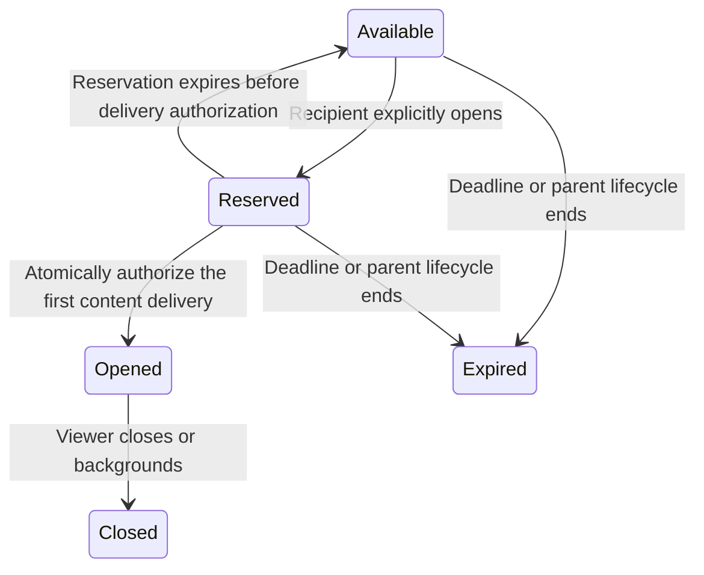

# Messaging: attachments, reactions, and view-once photos

Status: implementation proposal. No application or database changes are included in this plan.

## 1. Product direction

Extend the existing DM and den experience on web and native. Keep the current chat shell, details pane, bubble shapes, composer, typography, theme tokens, incognito appearance, and tactile surfaces.

Use progressive disclosure: one attachment entry point, delivery options inside the selected photo preview, and reactions inside the existing message actions. Meaningful states should be visible; routine success should be quiet.

### Recommended defaults

| Decision | Recommendation |
| --- | --- |
| View-once scope | Still photos in DMs, dens, and incognito DMs. One viewing session per eligible recipient across all their devices. |
| Default delivery | Keep in chat. View once is an explicit choice for each photo and resets for new selections. |
| Unopened lifetime | Proposed default: 24 hours, shortened by message expiry, deletion, membership loss, or incognito ending. Disclose this in the delivery control's contextual description. |
| After viewing | After authorized opening, closing ends that viewing session; returning to the chat shows an Opened placeholder. |
| Quick reaction | Double-click on desktop or double-tap on touch adds a heart. Repeating it keeps the heart selected. |
| Reaction selection | One emoji per person per message. Choosing another replaces it; tapping your selected reaction removes it. |
| Attachment count | Keep the existing ten-attachment message limit; enforce a bounded aggregate byte budget as well. |
| Limits | Reuse server-configured media limits. Current defaults are 25 MiB for images/documents and 250 MiB for videos. Publish effective limits to clients rather than duplicating defaults. |

The unopened lifetime is a proposed product default, separate from the once-only viewing rule. It should remain configurable.

## 2. What the repository already provides

- Web attachment staging, cancellation, retries, ownership tracking, image editing, and image albums already exist in `apps/web/src/components/messages/`.
- The DM attachment contract currently accepts images/GIFs. The native composer also requests images only. Video support elsewhere in the app does not yet establish complete DM video support.
- `packages/media/src/types.ts` already defines image, video, audio, and document media. The shared pipeline provides limits, scanning/status stages, and multipart upload infrastructure. Large web uploads already skip the full-file deduplication hash pass.
- Shared and native message payload definitions/parsers currently duplicate some media rules. Extend them together and move portable validation into `@asm/messages` where practical.
- Web already has a contextual message menu with desktop popover and touch sheet presentations. Native long press currently starts selection; swipe replies and media viewing also have established gestures.
- Normal chat has realtime events and durable change replay. Incognito has its own stream and lifecycle. Neither currently implements persisted message reactions or view-once access.
- Existing media access checks already handle membership, blocks, expiry, and incognito. View-once enforcement must extend every serving path, including owner access, originals, variants, thumbnails, and downloads.

## 3. Attachment UX

### Entry and selection

Replace the image-only attachment control with one paperclip/plus control in the same composer position.

| Action | Presentation |
| --- | --- |
| Photos & videos | Existing system/library picker, now accepting both types. |
| Files | System file picker for supported file types. |
| Camera | Native camera entry, requesting permission only when selected. |
| GIF | Keep the existing GIF shortcut and picker. |

Use the current popover primitive on desktop and the established bottom sheet on touch. Paste and drag/drop feed the same validation and staging flow. The drop target appears only during a supported drag.

### Preview before sending

- Photos/videos use a compact thumbnail rail above the input. Videos have a poster, play glyph, and duration; do not autoplay staged videos.
- Files use compact rows with a file icon, filename, extension, size, and remove action. Long names truncate visually but remain available to assistive technology and the expanded preview.
- Selecting a photo opens the existing editing/preview surface. Put a small circled-one delivery control beside the existing editing actions: Keep in chat / View once.
- Selecting View once updates the control's selected state and adds a small circled-one badge to that staged photo. Use an accessible label and tooltip, not color alone.
- If a batch includes view-once photos, show them separately from the ordinary album in the preview. Typed text is visibly separate and is sent as an ordinary text message; it must not silently become a supposedly protected caption.
- Show upload progress and processing state on the relevant item. A failure offers Retry and Remove on that item. Preserve the text and successful uploads.
- Make Send available when all remaining selected items are ready. Do not silently discard failed items or automatically send a partial batch.

### Appearance after sending

| Content | Chat rendering |
| --- | --- |
| Photos | Existing album layout with reserved image dimensions. |
| Videos | Matching album tiles with poster, duration, and play action; use existing playback infrastructure. |
| Documents/files | A compact file card with filename, type, size, and an explicit download action. |
| Mixed batches | Preserve selection order. Group adjacent ordinary photos/videos into albums; render files and view-once photos as distinct message units under one send batch. |

Each batch unit has its own idempotency identifier. If sending later units fails, Retry sends only the unsent units. Never duplicate already delivered items.

Add a Files filter within shared media in the existing details pane. Ordinary media remains discoverable there; protected photo content never enters that gallery.

## 4. View-once photo UX

### Sender

1. Choose a photo and optionally edit it.
2. Select View once in its preview. The control's contextual description is: “Opens once · available for 24 hours” for the proposed default.
3. Send using the normal composer action. No confirmation dialog or success toast.
4. Display a compact Photo · View once card. After sending, the sender cannot reopen the uploaded copy through chat. Their original device photo is outside this feature's control.

The option is discoverable through its icon and label in the preview; it does not create another permanent composer button or onboarding modal.

### Recipient

1. See the same compact card with a circled-one glyph and View once label. Use a neutral textured surface, not a blurred preview of the actual image.
2. Tap to open an isolated full-screen viewer with an obvious close action. No second confirmation.
3. Load with restrained progress feedback. Do not consume the photo because its card scrolled into view, the viewer mounted, or a preview was requested.
4. Once the server authorizes content delivery, that recipient has one viewing session. Closing, navigating away, or backgrounding closes it and clears application-held image buffers.
5. The card becomes Opened. Unopened content reaching its deadline becomes Expired. Exact timestamps belong in message information, not another row of permanent helper text.

Do not show a countdown. A short internal transfer/retry grant is a transport mechanism, not a timed viewing UI.

### Dens and incognito

- In dens, each eligible recipient opens independently. A person's first device claims their viewing session; their other devices update immediately. Opening must never consume another member's entitlement.
- Freeze eligible recipients at send time using membership semantics already used by the conversation. A later join does not gain access to an earlier protected photo.
- Put sender-facing per-recipient opening details inside message information, with pagination for larger dens.
- In incognito, the earliest applicable expiry wins: photo deadline, message's individual 24-hour deadline, or session ending. Incognito still has no whole-session countdown.
- Normal chats retain only the Opened/Expired placeholder according to normal history rules. Incognito placeholders and reactions disappear with their parent messages; the existing incognito usage stamp remains independent.

### Access and retry contract

Implement this as a server-enforced viewing session, with proposed states:

- Preflight checks object readiness and access before reserving. A reservation alone does not spend the entitlement.
- Atomically commit Opened immediately before releasing usable content. Persist a grant bound to the authenticated recipient, source, and specific viewer session.
- A lost response or interrupted transfer retries within that same short, bounded grant. Repeating an idempotent request does not create another viewing session. Another tab/device cannot claim it.
- A post-authorization crash cannot safely be treated as proof that no photo was seen. Do not promise consumption only after a client reports successful display, or reset Opened from a client error report.
- New requests always recheck expiry, membership, blocks, and source validity. Revocation signals also close a cooperating active viewer.
- Delete original and derivative objects after all eligible recipients have consumed the photo and authorized transfers have finished or expired, or earlier on lifecycle expiry. Retry physical erasure failures while denying access immediately.

Protected delivery uses an opaque attachment reference, never a reusable original URL embedded in the message. Store the authoritative delivery policy outside encrypted client payloads so forged payloads cannot downgrade protection.

Staging must isolate protected objects from public or reusable deduplication. Changing delivery mode re-authorizes/re-stages an isolated object when necessary. The sender may preview their private staged upload before sending; ownership must not bypass the protected policy afterward.

Exclude original bytes and previews from gallery indexing, link previews, notifications, exports, ordinary downloads, offline search storage, service-worker storage, native disk image caches, and persistent drafts. Use private, no-store responses throughout protected delivery, while recognizing that this header governs compliant caches rather than guaranteeing secure erasure. [Cache-Control reference](https://developer.mozilla.org/en-US/docs/Web/HTTP/Reference/Headers/Cache-Control)

On native, use supported capture protection and app-switcher protection scoped to the viewer, with proper cleanup and device testing. Avoid requesting broad photo-library permission just to detect screenshots. Capture protection cannot prevent an external camera, and web must not promise screenshot prevention. Keep that limitation in contextual help. [Expo SDK 57 ScreenCapture](https://docs.expo.dev/versions/v57.0.0/sdk/screen-capture/)

## 5. Reactions UX

### Adding, changing, and removing

- Double-click/tap the non-interactive message body to add a heart immediately. A small local confirmation animation, and one native haptic when enabled, are sufficient.
- Repeating a double-click keeps the heart selected. Remove it by tapping your selected reaction chip or using the picker. This avoids an accidental second gesture undoing a reaction.
- Add React to the existing message dropdown. Open a compact row of six familiar emojis (❤️ 👍 😂 😮 😢 🔥) and a plus action for a searchable full picker.
- On touch, use the existing contextual sheet. Preserve long-press selection and swipe-to-reply; add React to the single-message selection toolbar so it remains available without an ambiguous new long-press behavior.
- Photos, video controls, links, downloads, quoted-message jumps, and viewer zoom retain their direct actions. Quick-react gestures apply to the surrounding bubble, with React available for every supported message kind through the menu. Do not delay every media open while waiting for a possible second tap.
- Drag selection and Copy remain available on desktop. Distinguish a deliberate quick reaction from a drag or existing selection; disable quick reactions during multi-selection.

### Placement and visual treatment

- Render a small reaction cluster directly below its bubble, aligned to the bubble edge and kept clear of timestamps/receipts.
- Show at most three emoji groups inline, then +N for additional groups. Show counts where useful; tapping the overflow opens a paginated participant sheet. Participant details are also available in message information, including when there is only one emoji group.
- Selecting an emoji replaces your previous one. Your own selection uses a subtle theme accent and an accessible selected state.
- Use the existing chip/surface construction. Use Lucide for control icons; actual Unicode emoji are the reaction content.
- Mount one picker per open conversation, not one full picker for every bubble. Lazy-load the full emoji catalogue.
- Preserve transcript anchoring when a cluster appears or disappears. Animate only the changed chip, roughly 120–180 ms, with reduced-motion support.
- No success toast, permanent gesture tutorial, or new system-message row. On failure, roll back only the failed operation and offer a small local Retry action.

### Data and synchronization

- Add normalized reaction state with exactly one parent source: normal message or incognito message. Enforce one reaction per actor and source with database constraints.
- Validate complete emoji sequences, including skin tones, flags, and joined emoji. Store a validated canonical emoji as access-controlled conversation metadata under the existing server-recoverable trust model. This is not an E2EE claim; do not expose reaction content in logs or push previews.
- Use idempotent set/remove operations, a monotonic target revision, and per-message mutation ordering. Late responses must not overwrite a newer local choice.
- Maintain bounded count summaries transactionally. Hydrate summaries for the visible message batch; paginate people and additional emoji groups. Avoid requests per bubble.
- Add reaction change events and reconnect reconciliation to both normal and incognito transports. Events invalidate only affected messages; reacting does not edit/re-encrypt the message or trigger full text reindexing.
- Reaction changes do not count as newly received messages or advance read watermarks. Deleted/expired messages reject new reactions and remove existing ones with the source.

## 6. Shared implementation foundation

### Contracts and services

- Version attachment payloads with explicit image/video/file/view-once discriminants and stable media identifiers. Preserve legacy single-image and album decoding.
- Validate filename, MIME family, byte size, dimensions/duration, attachment count, and the aggregate send budget at server boundaries.
- Reuse the existing private upload/status/multipart infrastructure. Keep upload concurrency bounded, preserve large-upload hash skipping, and audit native transfers for full-file memory buffering.
- Documents require an explicit supported-type policy, content sniffing, malware scanning, safe filenames, and authorized attachment downloads. Keep active content out of inline rendering; enforce bounded archive inspection if archives are enabled. [OWASP File Upload guidance](https://cheatsheetseries.owasp.org/cheatsheets/File_Upload_Cheat_Sheet.html)
- Ensure original-retention sweeps cannot delete the only downloadable copy of a still-valid file message.
- Add a viewer entitlement/grant service, bounded cleanup jobs, and centralized media admission checks. Every derivative and owner/download path must participate.
- Update reply summaries, conversation previews, message exports, search references, notification text, media galleries, and both client parsers for the new attachment kinds. Protected content only produces generic labels.

### Candidate persistence changes

| Record | Purpose |
| --- | --- |
| Attachment delivery metadata | Authoritative policy, source ownership, expiry, protected object identity. Extend the current media-link structure where appropriate. |
| View-once recipient state | Unique attachment/recipient entitlement, opening state, and revision. Indexed for claims and expiry. |
| View-once grant | Short-lived viewer session, reservation/transfer bounds, request idempotency, and revocation. |
| Reaction state and count summaries | Unique actor/source choice, revision, and bounded aggregate reads. |

Use actual foreign keys for each source and an exactly-one-source constraint, matching the current normal/incognito media-link pattern. Recipient state is bounded by eligible membership, never preallocated per device.

All migrations are additive. Existing messages remain ordinary messages. Follow the repository's Prisma 8 contract and generated migration workflow, review locking/backfills, and prebuild indexes where required for populated tables. Never rewrite applied migration history or reset existing data.

## 7. Delivery sequence

| Phase | Deliverable | Completion gate |
| --- | --- | --- |
| 1. Contracts and compatibility | Attachment kinds, validated limits, fallback readers, source identities, event contracts, additive schema. | Old messages render identically; incompatible clients cannot reveal protected assets. |
| 2. Composer and ordinary attachments | One attachment menu, photo/video previews, file rows, mixed batch sending, file cards, details-pane Files filter. | Web/native parity; partial retries do not duplicate sends; bounded memory. |
| 3. Reactions | Quick gestures, menu/picker, chips, optimistic mutations, realtime and replay. | Gesture arbitration, concurrent changes, and scrolling remain correct. |
| 4. View-once enforcement and UX | Staging policy, recipient claims, viewer, cleanup, lifecycle/media-route integration. | Concurrent devices, retries, cache exclusions, and expiry pass integration tests. |
| 5. Release validation | Compatibility rollout, accessibility review, low-end device measurements, staged feature flags. | Security and regression gates pass before enabling view-once sending. |

Deploy tolerant readers and access restrictions before enabling new writers. Test real older client behavior. Where a safe update-required experience is not established, keep the affected feature disabled until client compatibility is resolved. Never fall back to rendering a protected photo as ordinary media.

Use separate flags for ordinary attachments, reactions, and view-once sending. Disabling a flag stops new writes while preserving protected access enforcement and already-sent history.

## 8. Acceptance criteria

- The same chat shell and details pane remain mounted across normal/incognito use. No second composer design or independent upload implementation.
- Every new control works in light/dark themes, at narrow mobile widths, with keyboard navigation and screen readers. Touch hit areas reach platform minimums without making every icon visually larger.
- View-once content is never fetched by list rendering or prefetch. Two devices cannot receive independent grants for the same recipient entitlement.
- Failures before delivery authorization remain retryable without spending the entitlement; failures afterward retry only within the original grant.
- One den recipient's viewing does not consume another's. All parent expiry, block, membership, clear/delete, and incognito-end cases are enforced.
- Protected bytes cannot escape through an original/thumbnail/download/export route, persistent cache, deduplication reuse, or message quote.
- Reactions survive reconnect and converge across devices; rapid add/change/remove sequences do not create duplicates or resurrect deleted choices.
- File progress, processing, cancellation, retry, malicious/unsupported types, server limit changes, and interrupted batches behave consistently on both clients.
- Run focused unit/integration tests for these contracts and end-to-end gesture/viewer flows, followed by repository lint/type checks. Measure scrolling, upload memory, and tap response on a representative low-end physical device; do not infer device performance from desktop emulation alone.
- Product copy stays limited to action labels, useful per-item progress, Opened/Expired state, and recoverable errors. Exact expiry details and capture limitations stay contextual.

## 9. Implementation map

- Shared contracts: `packages/messages/src/payload.ts`, `packages/messages/src/references.ts`, `packages/messages/src/lifecycle.ts`.
- Web composer/staging: `apps/web/src/components/messages/message-composer.tsx`, `message-attachment-state.ts`, `use-message-attachments.ts`, `message-attachment-strip.tsx`.
- Web message actions/rendering: `apps/web/src/components/messages/message-bubble.tsx`, `message-options-menu.tsx`, `message-thread.tsx`, the album/viewer and details components.
- Native composer/rendering/gestures: `apps/mobile/src/features/messages/components/message-composer.tsx`, `message-bubble.tsx`, `message-thread-screen.tsx`, `use-transcript-gestures.tsx`, and `apps/mobile/src/features/messages/lib/crypto.ts`.
- Persistence and lifecycle: `packages/db/prisma/contract.prisma`, `packages/db/src/messages/`, and media cleanup workers.
- Delivery: `apps/web/src/lib/media/message-media-access.ts`, `apps/web/src/app/api/media/`, the shared upload client, and native media upload/picker adapters.
- Synchronization: normal change replay and both web/native realtime parsers, plus incognito lifecycle events.

Suggested new UI units: AttachmentMenu, AttachmentPreview, FileMessageCard, ViewOncePhotoCard, ViewOnceViewer, MessageReactionBar, and ReactionPicker. Names are illustrative; reuse the existing primitives and domain helpers rather than creating parallel component systems.
